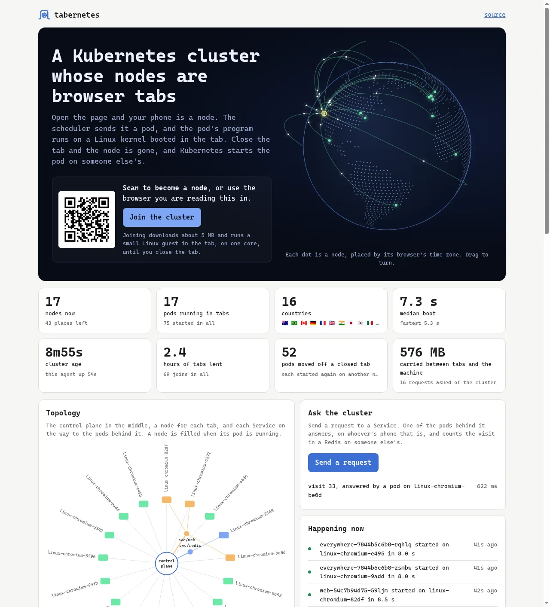

<p align="center">
  
</p>

<h1 align="center">tabernetes</h1>

<p align="center">
  <b>A Kubernetes cluster whose nodes are browser tabs.</b>
</p>

<p align="center">
  <a href="#join">Join</a> ·
  <a href="#run-a-pod-in-a-tab">Run a pod</a> ·
  <a href="#how-it-works">How it works</a> ·
  <a href="#run-your-own">Run your own</a> ·
  <a href="#hacking">Hacking</a> ·
  <a href="docs/design.md">Design</a>
</p>

<p align="center">
  <a href="https://github.com/fzakaria/tabernetes/actions/workflows/ci.yml"></a>
</p>

tabernetes is a kubelet for browser tabs. Open a page and your phone is
a node of a Kubernetes cluster. The scheduler sends it a pod, and the
pod's program runs on a Linux kernel booted in the tab. Close the tab
and the node is gone, and Kubernetes starts the pod on someone else's
phone.

<p align="center"><a href="docs/img/dashboard.webp"></a></p>

```console
$ kubectl get nodes -o wide
NAME                  STATUS   VERSION        OS-IMAGE                   KERNEL-VERSION           CONTAINER-RUNTIME
pixel-11-pro-3145     Ready    v1.37.2+k3s1   Chrome 158 on Android 17   7.3.4-unkernel (arm64)   tabc://1.0.0
linux-chromium-ef05   Ready    v1.37.2+k3s1   Chromium 157 on Linux      7.3.4-unkernel (arm64)   tabc://1.0.0
tabernetes            Ready    v1.37.2+k3s1   Ubuntu 24.04.5 LTS         6.12.115 (amd64)         containerd://2.3.7-k3s1
```

The control plane is an ordinary Kubernetes, k3s on one small machine.
The nodes are whoever has the join page open.

## Join

Open [tabernet.es](https://tabernet.es), or scan the code on it, and
press Join. The tab becomes a node, named after the device, and shows
the pod it was given: a terminal on a Linux that is running in the tab.
Close the tab to leave.

The page also shows the cluster: a globe with a dot for each node that
can be picked, the Services and the pods behind them, and a button that
sends a request to a web server on someone's phone.

## Run a pod in a tab

A pod asks for a tab by its RuntimeClass, and is otherwise a pod:

```yaml
apiVersion: v1
kind: Pod
metadata:
  name: hello
spec:
  runtimeClassName: tab
  containers:
    - name: hello
      image: alpine
      command: ["sh", "-c", "echo hello from $(uname -m); sleep 3600"]
```

```console
$ kubectl apply -f examples/hello.yaml
$ kubectl get pod hello -o wide
NAME    READY   STATUS    AGE   IP             NODE
hello   1/1     Running   6s    10.244.128.2   linux-chromium-ef05
$ kubectl logs hello
hello from aarch64 Linux 7.3.4+, in a browser tab
```

The guest is aarch64 on every device, so the image needs a
`linux/arm64` variant. [examples](examples) has two more:

| example           | what it is                                                    |
| ----------------- | ------------------------------------------------------------- |
| `counter.yaml`    | a web server on every tab, and the Redis they count visits in |
| `everywhere.yaml` | a DaemonSet whose pod on every tab tells the time             |

What a tab's pod can have:

- One container, one CPU, 128 to 256 MiB of memory.
- `command`, `args`, `env`, `workingDir`, TCP `ports`, `emptyDir` and
  `hostPath` volumes, `restartPolicy`, an HTTP `readinessProbe`.
  `kubectl logs` works. `kubectl exec`, init containers, config maps
  and secrets do not, yet.
- Other pods and Services to talk to, and nothing else. A pod on a tab
  is a stranger's browser speaking from the cluster's machine, so the
  machine's firewall refuses it the internet, the API server and the
  machine itself.
- No secrets. The tab holds the pod's memory and can read all of it.

## How it works

1. One agent runs beside the API server and plays kubelet for every tab
   at once.
2. A browser that opens the join page holds a WebSocket to the agent.
   The agent registers a Node for it, named after the device.
3. When the scheduler binds a pod to that Node, the agent gives the pod
   a network namespace and an address on the machine, and starts the
   container there with [tabc], a runtime that runs a container in a
   browser tab.
4. The agent tells the page, and the page opens a frame on the
   container. The frame boots [unkernel], a Linux kernel compiled to
   WebAssembly, and runs the program.
5. The tab supplies the CPU and the memory. The container's files and
   its network stay on the machine: every connection the program makes
   leaves from the pod's address there, so a Service reaches a pod on a
   phone like any other pod.
6. When the socket closes, the agent deletes the Node and its pods, and
   their controllers make new pods for other nodes.

[docs/design.md](docs/design.md) has the details, the measurements and
what is missing.

## Run your own

On any x86-64 Linux machine with systemd, root, and a kernel that has
bridges and network namespaces:

```console
$ nix run github:fzakaria/tabernetes#deploy -- <ssh host> <public address>
```

That copies the agent and tabc over, installs k3s if the machine has
none, and starts the agent on port 8000. Put HTTPS in front of the port
and open the address.

| variable                | what it sets                                         |
| ----------------------- | ---------------------------------------------------- |
| `MAX_NODES`             | the most tabs that may be nodes at once, 1000        |
| `MAX_NODES_PER_ADDRESS` | how many of them from one address, 4                 |
| `SEEDS`                 | headless browsers the machine keeps as nodes, 0      |
| `UNKERNEL_MIRROR`       | where tabs fetch the kernel, jsDelivr; empty for own |
| `ZONE`                  | the time zone the machine is in, for the globe       |
| `DEMO`                  | `no` leaves the examples out                         |

How many nodes the cluster takes is the machine's to say: a node costs
it about 9 MB, and the agent turns tabs away once less than 1 GB of
memory is spare, whatever `MAX_NODES` is.

## Hacking

```console
$ nix build               # the agent, one static file
$ nix flake check         # the tests, and the bundle a deploy copies
$ nix run .#globe-data    # the globe's tables, when a time zone is made
$ nix fmt                 # before committing
```

## Credits

[tabc] runs the containers, and [unkernel], by Pooya Parsa, is the
kernel they run on. The globe's land is [Natural Earth]'s.

## License

MIT, please see [LICENSE](LICENSE).

[tabc]: https://github.com/fzakaria/tabc
[unkernel]: https://github.com/pithings/unkernel
[Natural Earth]: https://www.naturalearthdata.com
